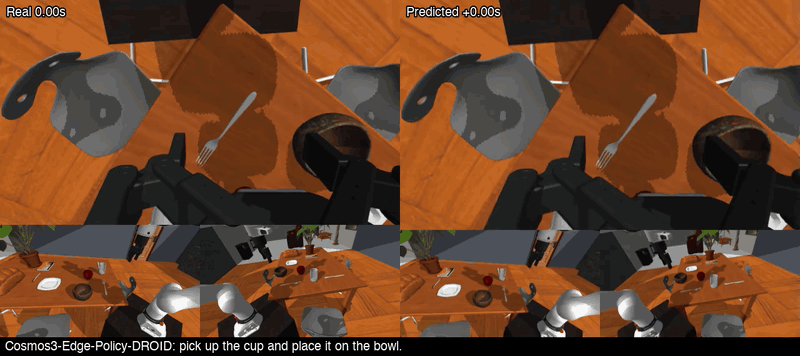
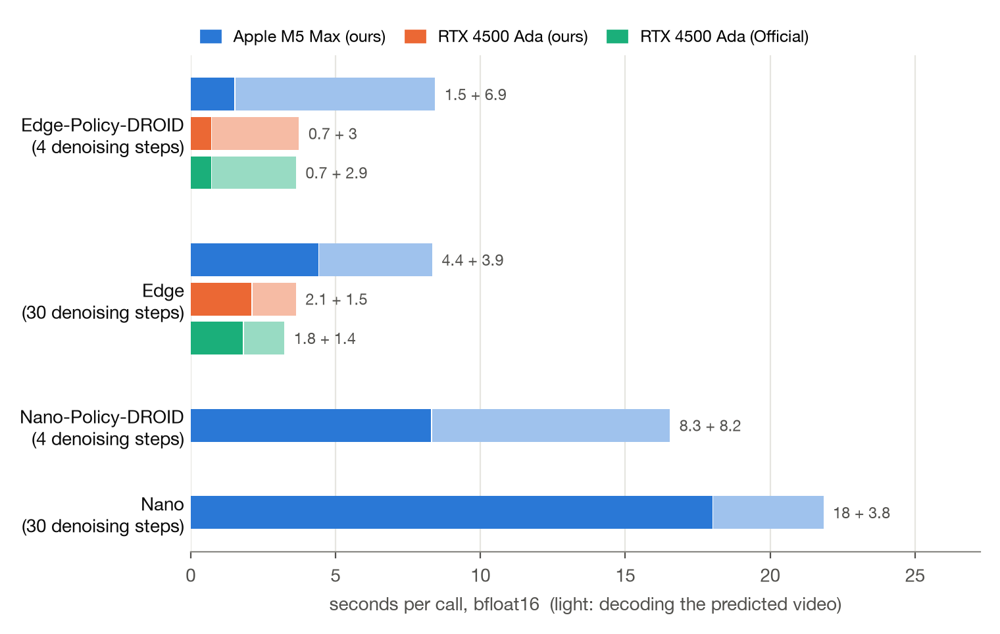
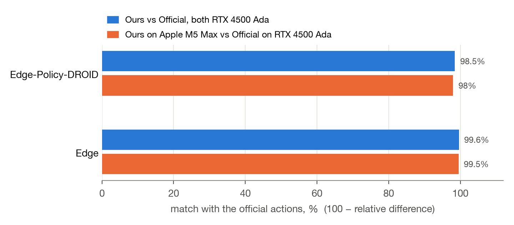
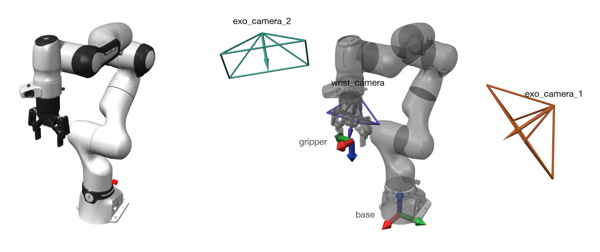
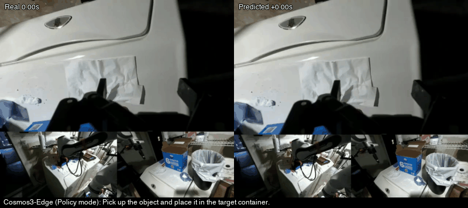

# NVIDIA Cosmos3 policy models in MuJoCo

Runs NVIDIA's Cosmos3 policy models on Apple Silicon Macs ([notes](MACOS.md)) and NVIDIA GPUs:

- [Cosmos3-Edge-Policy-DROID](https://huggingface.co/nvidia/Cosmos3-Edge-Policy-DROID) and [Cosmos3-Nano-Policy-DROID](https://huggingface.co/nvidia/Cosmos3-Nano-Policy-DROID) on a [Franka](#molmospaces-1) in the [MolmoSpaces](https://github.com/allenai/molmospaces) [MuJoCo](https://mujoco.org) benchmarks.
- The base models [Cosmos3-Edge](https://huggingface.co/nvidia/Cosmos3-Edge) and [Cosmos3-Nano](https://huggingface.co/nvidia/Cosmos3-Nano) on recorded [DROID](https://droid-dataset.github.io) episodes, in [policy or forward dynamics mode](#real-robot-recordings).

<p align="center">
  
</p>
<p align="center">
  <b>Left:</b> camera images the model receives  |  <b>Right:</b> video the model predicts along with its actions<br>
  Cosmos3-Edge-Policy-DROID on <a href="https://github.com/allenai/molmospaces">MolmoSpaces</a> pick-and-place episode 239: "pick up the cup and place it on the bowl"
</p>

To make these videos, start the policy server ([Run](#run)), then:

```bash
conda activate benchmark-molmospaces
python scripts/molmospaces/run_all.py --model edge-droid-policy --benches PickAndPlace-v1 --episode 239 --decode-video
```

## Models


| Model                                                                                                                                                  | What it is                                                                     | `--model`                               |
| ------------------------------------------------------------------------------------------------------------------------------------------------------ | ------------------------------------------------------------------------------ | --------------------------------------- |
| [Cosmos3-Edge](https://huggingface.co/nvidia/Cosmos3-Edge) (4B)                                                                                        | base model: predicts future video and robot actions                            | `edge-base-policy`                      |
| [Cosmos3-Edge-Policy-DROID](https://huggingface.co/nvidia/Cosmos3-Edge-Policy-DROID)                                                                   | Cosmos3-Edge fine-tuned as a [DROID](https://droid-dataset.github.io) policy | `edge-droid-policy` (default)           |
| [Cosmos3-Nano](https://huggingface.co/nvidia/Cosmos3-Nano) (16B), [Cosmos3-Nano-Policy-DROID](https://huggingface.co/nvidia/Cosmos3-Nano-Policy-DROID) | the larger versions of the two above                                           | `nano-base-policy`, `nano-droid-policy` |

Each model call takes a camera image and a task instruction, and returns the next chunk of actions:


| Model              | Each action                                                      | Where it runs here                                                                             |
| ------------------ | ---------------------------------------------------------------- | ---------------------------------------------------------------------------------------------- |
| Base (Policy mode) | ee pose delta (3 position + 6 rotation values) + gripper         | [recorded DROID episodes](#real-robot-recordings): policy or forward dynamics                  |
| Policy-DROID       | 7 joint angles + gripper; it also reads the current joint angles | [MolmoSpaces' DROID Franka](#molmospaces-1); [recorded DROID episodes](#real-robot-recordings) |

The models run in bfloat16. In MolmoSpaces, [`--full-precision`](#options-and-outputs) runs float32: nearly the same results on every GPU, but about 4 times slower. Edge needs about 17 GB of GPU memory, Nano about 70 GB.

> [!IMPORTANT]
> On macOS, use **[PyTorch](https://pytorch.org) 2.13.0 or later.** Older versions make the Policy-DROID actions jittery ([MACOS.md](MACOS.md)).

## Time per model call

Seconds per call / to decode the predicted video (`--decode-video`), in bfloat16.

<p align="center">
  
</p>


| Model                                         | Mac (ours) | CUDA (ours) | CUDA (official code)                                                       |
| --------------------------------------------- | ---------- | ----------- | -------------------------------------------------------------------------- |
| Cosmos3-Edge-Policy-DROID (4 denoising steps) | 1.5 / 6.9  | 0.7 / 3.0   | 0.7 / 2.9 ([NVIDIA's server](https://github.com/NVIDIA/cosmos-framework/blob/bf492fe/docs/action_policy_droid_server.md))   |
| Cosmos3-Edge (30 denoising steps)             | 4.4 / 3.9  | 2.1 / 1.5   | 1.8 / 1.4 ([cosmos-framework](https://github.com/NVIDIA/cosmos-framework)) |
| Cosmos3-Nano-Policy-DROID (4 denoising steps) | 8.3 / 8.2  | –          | –                                                                         |
| Cosmos3-Nano (30 denoising steps)             | 18 / 3.8   | –          | –                                                                         |

Mac: M5 Max (40-core GPU, 128 GB). CUDA: RTX 4500 Ada (24 GB), too small for Nano.

## Numerical differences

Both sides get the same camera image, robot state, prompt and starting noise. The table gives the mean absolute difference between our actions and the official ones; in parentheses, that difference divided by the official actions' mean absolute value. The plot shows 100% minus that share.

<p align="center">
  
</p>


| Model                     | Official code                                                                                                        | Ours  vs official, both on CUDA bfloat16 | Ours on Mac bfloat16 vs official on CUDA bfloat16 |
| ------------------------- | -------------------------------------------------------------------------------------------------------------------- | ------------------------------------------ | ------------------------------------------------- |
| Cosmos3-Edge-Policy-DROID | [NVIDIA's policy server](https://github.com/NVIDIA/cosmos-framework/blob/bf492fe/docs/action_policy_droid_server.md) | 0.012 rad (1.5%)                           | 0.015 rad (2%)                                    |
| Cosmos3-Edge              | NVIDIA's [cosmos-framework](https://github.com/NVIDIA/cosmos-framework)                                               | 0.0013 (0.4%)                              | 0.0019 (0.5%)                                     |

**Why ours differs on the same GPU.** bfloat16 rounding. A few kernels, operation orders and dtypes differ from NVIDIA's code, and the denoising steps grow these last-bit differences. We keep [Diffusers](https://github.com/huggingface/diffusers)' defaults and [`torch.compile`](https://pytorch.org/docs/stable/generated/torch.compile.html).

**Why Policy-DROID differs most.** Its first step uses guidance with scale 3 ([sampling settings](#implementation)), which multiplies the difference (3.5%, against about 1% unguided), and with only 4 denoising steps that step dominates.

The gap is about as large as NVIDIA's own run-to-run change (0.019 rad for Policy-DROID): its server picks cuDNN kernels by timing, so it isn't repeatable unless [`cudnn.benchmark`](https://pytorch.org/docs/stable/backends.html#torch.backends.cudnn.benchmark) is off.

## Setup

The model and the simulations run in separate [conda](https://docs.conda.io) envs ([`envs/`](envs)). Run all commands from the repository root.

### Policy server and models

```bash
git clone https://github.com/NVIDIA/cosmos-framework.git models/cosmos-framework
git -C models/cosmos-framework checkout bf492fe

conda env create -f envs/policy_server.yaml   # Python 3.11, requirements.txt
conda activate cosmos3-policy-server

hf auth login   # accept the model licenses on Hugging Face if asked
hf download nvidia/Cosmos3-Edge --local-dir models/cosmos3_checkpoints/Cosmos3-Edge
hf download nvidia/Cosmos3-Edge-Policy-DROID --local-dir models/cosmos3_checkpoints/Cosmos3-Edge-Policy-DROID
# Optional: Nano (~30 GB each)
hf download nvidia/Cosmos3-Nano --local-dir models/cosmos3_checkpoints/Cosmos3-Nano
hf download nvidia/Cosmos3-Nano-Policy-DROID --local-dir models/cosmos3_checkpoints/Cosmos3-Nano-Policy-DROID
# Optional: real robot recordings (NVIDIA's examples need git-lfs)
git -C models/cosmos-framework lfs pull --include ".agents/skills/cookbooks/cosmos3/generator/action/assets/**"
hf download lerobot/droid_100 --repo-type dataset --local-dir datasets/droid_100
# Optional: DROID failure/success pairs (droid_sample), picked from DROID's raw data with its crowd annotations
curl -o datasets/droid_sample/aggregated-annotations-030724.json --create-dirs \
    https://storage.googleapis.com/gresearch/robotics/droid_raw/1.0.1/aggregated-annotations-030724.json
python scripts/download_droid_pairs.py --pairs 100   # 200 episodes
```

### MolmoSpaces

```bash
bash envs/molmospaces.sh   # benchmark-molmospaces: MolmoSpaces v0.2.9 in benchmarks/, ~13 GB of assets
```

## Run

Start the policy server and leave it running. It keeps one model in memory; a run with another model replaces it. Ctrl-C frees the GPU.

```bash
conda activate cosmos3-policy-server
python scripts/policy_server.py   # ws://localhost:8000
```

In a second terminal, run [MolmoSpaces](#molmospaces-1) in `benchmark-molmospaces`. Scripts without a simulation run in `cosmos3-policy-server`. The same commands work on the Mac and on CUDA.

Quick test, one 3 s episode:

```bash
python scripts/molmospaces/run_demo.py --seconds 3
```

### MolmoSpaces

Episodes run through [MolmoSpaces](https://github.com/allenai/molmospaces)' own evaluation: its houses, start states, time limits and success check, so results compare with its [leaderboard](https://molmospaces.allen.ai/leaderboard). The robot is MolmoSpaces' DROID Franka. The DROID models take two exterior cameras, so `exo_camera_2` mirrors the episode's exterior camera.

<p align="center">
  
</p>
<p align="center">
  <b>Left:</b> MolmoSpaces' DROID Franka at the start of PickAndPlace-v1 episode 239  |  <b>Right:</b> its frames and cameras<br>
  Axes: x red, y green, z blue. Base: +x forward, +z up. Gripper: +z forward, fingers open along y. Arrows: where each camera looks.
</p>

```bash
python scripts/molmospaces/run_demo.py --bench PickAndPlace-v1 --episode 0 --decode-video   # one episode
python scripts/molmospaces/run_all.py                                                     # all benches
python scripts/molmospaces/run_all.py --benches PickAndPlace-v1 --episode 194             # some episodes
```

Our changes to MolmoSpaces' evaluation:

- Each episode starts with a 3 s settle: the arm holds still and the model isn't called. It ends after the model call in which it first succeeds.
- [`run_all.py`](scripts/molmospaces/run_all.py) skips finished episodes, and the Filament benches (Pick-v2-filament, PickAndPlace-v2, -Color-v2, -NextTo-v2), which need MuJoCo's Filament build.

### Real robot recordings

The model gets recorded camera images instead of a simulation, and predicts actions and video (`--decode-video` saves it). Saves to `outputs/recording/`.

<p align="center">
  
</p>
<p align="center">
  <b>Left:</b> recorded camera images  |  <b>Right:</b> video the model predicts<br>
  Cosmos3-Edge (Policy mode) on NVIDIA's <a href="https://github.com/NVIDIA/cosmos-framework/tree/bf492fe/.agents/skills/cookbooks/cosmos3/generator/action">DROID example</a>
</p>

```bash
python scripts/predict_on_recording.py --model edge-droid-policy --decode-video                  # NVIDIA's DROID example
python scripts/predict_on_recording.py --model edge-base-policy --dataset droid_100 --episodes 3     # DROID-100
```

On `droid_sample` ([download](#policy-server-and-models)), Policy-DROID also gets the recorded joint angles. Episodes 0-99 are failures, 100-199 the successes that followed them (pair i: episodes i and i+100).

```bash
python scripts/predict_on_recording.py --model edge-base-policy --dataset droid_sample --episodes 0 100   # policy mode
python scripts/forward_dynamics.py --episodes 0 100                                                         # forward dynamics mode
```

In forward dynamics mode the base model gets the recorded actions and predicts only the video, 16 actions per call. Every 32 actions (one Policy-DROID call) it starts again from the recorded camera image; the call in between goes on from the last predicted frame.

### Options and outputs

MolmoSpaces' [`run_demo.py`](scripts/molmospaces/run_demo.py) and [`run_all.py`](scripts/molmospaces/run_all.py) (`--help` lists the rest):

- `--model`: `edge-droid-policy` (default) or `nano-droid-policy`.
- `--seconds`: time limit (default: the bench's own). It is rounded up to whole model calls, and after a success the current model call still plays out.
- `--decode-video`: also save the video the model predicts (slow).
- `--seed N`: every episode's noise seed. Default: random for `run_demo.py`; `run_all.py` gives each episode its own seed from its bench and index.
- `--full-precision`: float32 instead of bfloat16. The server runs one precision; restart it to switch.
- `--host`, `--port`: the policy server's address (default `localhost:8000`).
- `run_all.py` only: `--output-dir`, and `--chunk` / `--num-chunks` to split the episodes over several runs.

[`predict_on_recording.py`](scripts/predict_on_recording.py) takes `--dataset`, `--episodes`, `--model` (the base models too), `--seconds` (default: the whole episode), `--decode-video` and `--output-dir`. [`forward_dynamics.py`](scripts/forward_dynamics.py) takes `--episodes`, `--model` (`edge-base-fd` or `nano-base-fd`) and `--output-dir`.

[`run_demo.py`](scripts/molmospaces/run_demo.py) saves to `outputs/molmospaces_<model>_<bench>_ep<i>/`, [`run_all.py`](scripts/molmospaces/run_all.py) to `outputs/molmospaces/<model>/<bench>/ep<i>/`, next to MolmoSpaces' own results. Each episode saves these files (`cosmos3*` in MolmoSpaces):


| File              | Contents                                                                                                                                                                         |
| ----------------- | -------------------------------------------------------------------------------------------------------------------------------------------------------------------------------- |
| `_camera.mp4`     | the camera images the model got, one frame per action                                                                                                                            |
| `_prediction.mp4` | the video the model predicted (with `--decode-video`), one frame per action                                                                                                       |
| `.parquet`        | one row per model call: its input image and robot state, its actions and predicted video latent. Load it with `load_model_calls` ([`utils/episode_log.py`](utils/episode_log.py)) |
| `.json`           | prompt, cameras, model settings, time limit, success and when                                                                                                                    |

Frame k of both videos is the same moment. Each episode also saves one more model call on its last image, which is never played (`unplayed_model_call` in the .json).

[`scripts/decode_video_latents.py`](scripts/decode_video_latents.py) decodes a saved episode's predicted video later, into `_prediction.mp4`. Decoding is the slow part on the Mac, so a run can skip `--decode-video` and decode later, on the Mac or on CUDA.

## Implementation

All models run through [Diffusers](https://github.com/huggingface/diffusers)' Cosmos3 pipeline, with the changes below ([Numerical differences](#numerical-differences)).

**Changes to Diffusers**

Diffusers 0.41's general Cosmos3 pipeline ([`Cosmos3OmniPipeline`](https://github.com/huggingface/diffusers/blob/v0.41.0/src/diffusers/pipelines/cosmos/pipeline_cosmos3_omni.py)) gives different actions from NVIDIA's policy server. `Cosmos3ActionPipeline` ([`models/cosmos3_policy/pipeline.py`](models/cosmos3_policy/pipeline.py)) changes only these steps; the code links NVIDIA's version of each.


| Step                             | Diffusers 0.41                                                              | Ours                                                                                    |
| -------------------------------- | --------------------------------------------------------------------------- | --------------------------------------------------------------------------------------- |
| **Robot state** (Policy-DROID)   | not an input                                                                | joint angles and gripper openness as action row 0, marked as given                      |
| **Time of the state row**        | one frame after the camera image                                            | at the camera image's time                                                              |
| **Action size** (Policy-DROID)   | 10 values; the 2 unused ones stay noise and make actions ~1.5x more jittery | 8 values: 7 joints + gripper                                                            |
| **Camera image size**            | 640x540 shrunk to 640x528, then padded                                      | kept at 640x540, then padded                                                            |
| **Camera image layout**          | left to the user                                                            | our three cameras tiled with NVIDIA's code                                              |
| **Prompt**                       | the task only                                                               | plus NVIDIA's sentence on the DROID camera layout                                       |
| **Guidance**                     | every denoising step                                                        | Edge-Policy-DROID: only for timesteps 960-1001                                          |
| **Per-model settings**           | passed on every call                                                        | set once per model ([`models/cosmos3_policy/specs.py`](models/cosmos3_policy/specs.py)) |
| **VAE encoding** (speed only)    | the image and the placeholder frames for the future video                   | the image only; same result                                                             |
| **`torch.compile`** (speed only) | none                                                                        | each transformer layer                                                                  |

**Sampling settings**


| Model             | Denoising steps | Guidance                       | Shift | Actions per call              | From                                                                                                                                                                                                           |
| ----------------- | --------------- | ------------------------------ | ----- | ----------------------------- | -------------------------------------------------------------------------------------------------------------------------------------------------------------------------------------------------------------- |
| Edge-Policy-DROID | 4               | 3, only for timesteps 960-1001 | 5     | 32 at 15/s                    | [report](https://arxiv.org/abs/2606.02800) Table 21 and §4.2.5, model card, NVIDIA's [policy server instructions](https://github.com/NVIDIA/cosmos-framework/blob/bf492fe/docs/action_policy_droid_server.md) |
| Nano-Policy-DROID | 4               | 3, every step                  | 5     | 32 at 15/s                    | [report](https://arxiv.org/abs/2606.02800) Table 21                                                                                                                                                            |
| Edge, Nano (base) | 30              | 1                              | 5 (10 in forward dynamics) | 16 at 15/s | NVIDIA's [Diffusers action cookbook](https://github.com/NVIDIA/cosmos-framework/tree/bf492fe/.agents/skills/cookbooks/cosmos3/generator/action)                                                                 |

The negative prompt is empty for all models.

## Files

```
scripts/
  policy_server.py              the policy server: runs the models for the simulations
  molmospaces/                  run_demo.py runs one episode (run_episode), run_all.py the benches
  predict_on_recording.py       the models on recorded episodes, policy mode
  forward_dynamics.py           the base model on droid_sample, forward dynamics mode
  download_droid_pairs.py       DROID failure/success pairs (droid_sample)
  decode_video_latents.py       decode saved predicted videos later
models/
  cosmos3_policy/               our Diffusers pipeline, model client and per-model settings (Implementation)
utils/                          the play loop, episode logs and run options shared by the scripts
envs/                           conda envs: the policy server's and MolmoSpaces'
MACOS.md                        macOS notes
```

## Sources


| What                                                                                                              | Where it comes from                                                                                                                                                                                                                                                                                            | License                     |
| ----------------------------------------------------------------------------------------------------------------- | -------------------------------------------------------------------------------------------------------------------------------------------------------------------------------------------------------------------------------------------------------------------------------------------------------------- | --------------------------- |
| Cosmos3-Edge, Cosmos3-Nano and their Policy-DROID weights                                                         | NVIDIA, [Hugging Face](https://huggingface.co/nvidia/Cosmos3-Edge)                                                                                                                                                                                                                                              | OpenMDW 1.1                 |
| Policy server and its settings, action decoding, camera image layout                                              | NVIDIA [cosmos-framework](https://github.com/NVIDIA/cosmos-framework) (`models/cosmos-framework`)                                                                                                                                                                                                               | OpenMDW 1.1                 |
| Policy server message format ([`models/cosmos3_policy/msgpack_numpy.py`](models/cosmos3_policy/msgpack_numpy.py)) | Physical Intelligence [openpi](https://github.com/Physical-Intelligence/openpi) client                                                                                                                                                                                                                          | Apache 2.0                  |
| Sampling settings, DROID camera layout                                                                            | NVIDIA [Cosmos 3 report](https://arxiv.org/abs/2606.02800)                                                                                                                                                                                                                                                      |                             |
| Cosmos3 pipeline                                                                                                  | Hugging Face [Diffusers](https://github.com/huggingface/diffusers) 0.41                                                                                                                                                                                                                                         | Apache 2.0                  |
| Benchmark houses, objects, episodes, evaluation, DROID Franka                                                     | Allen AI [MolmoSpaces](https://github.com/allenai/molmospaces) v0.2.9 (`benchmarks/molmospaces`)                                                                                                                                                                                                                | Apache 2.0                  |
| Real robot recordings ([`scripts/predict_on_recording.py`](scripts/predict_on_recording.py))                      | NVIDIA's [Diffusers action cookbook](https://github.com/NVIDIA/cosmos-framework/tree/bf492fe/.agents/skills/cookbooks/cosmos3/generator/action/assets) examples; [DROID-100](https://huggingface.co/datasets/lerobot/droid_100) from LeRobot; [DROID](https://droid-dataset.github.io) raw data and annotations | OpenMDW 1.1; MIT; CC BY 4.0 |
